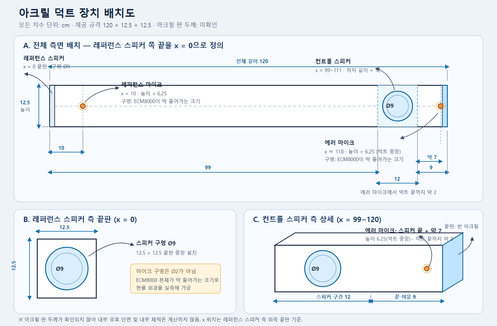
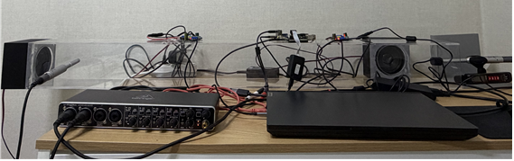
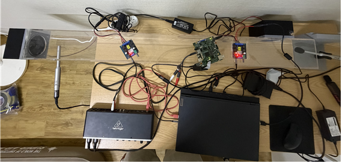

# SFANC 하드웨어 구성

## 사용 장비

| 구분 | 장비 |
|---|---|
| 마이크 | Behringer ECM8000 |
| 스피커 | DIY용 4인치 풀레인지 스피커 |
| 파워 앰프 | TPA3116D2 |
| 오디오 인터페이스 | Behringer UMC404HD |
| DSP | OMAP-L138 |
| 제어·모니터링 | PC |

## 신호 흐름

```text
ECM8000 마이크
    │ XLR
    ▼
UMC404HD 오디오 인터페이스
    │ 6.35 mm × 2 → RCA × 2 → 3.5 mm 스테레오(Y형)
    ▼
OMAP-L138 DSP
    │ 3.5 mm 오디오 출력
    ▼
TPA3116D2 파워 앰프
    │ 2심 스피커 케이블
    ▼
DIY 4인치 풀레인지 스피커
```

PC는 UMC404HD의 USB 오디오 연결, OMAP-L138의 USB 디버깅 연결, 그리고
OMAP-L138의 UART 필터 선택 통신에 사용한다.

## 아크릴 덕트 규격 및 배치



수정 가능한 벡터 원본: [`duct-layout.svg`](assets/duct-layout.svg)

- 제공된 덕트 규격은 길이 `120 cm`, 폭 `12.5 cm`, 높이 `12.5 cm`이다.
- 아크릴 판 두께는 확인되지 않아 내부 유효 치수는 아직 계산하지 않는다.
- 위치 좌표는 레퍼런스 스피커가 설치된 끝판을 `x = 0 cm`로 한다.
- 레퍼런스 스피커 장착 구멍의 지름은 `9 cm`이다.
- 레퍼런스 마이크는 `x = 10 cm`, 바닥 기준 높이 `6.25 cm`에 설치한다.
- 컨트롤 스피커는 `x = 99~111 cm` 구간을 차지하며, 장착 구멍의 지름은
  `9 cm`이다.
- 컨트롤 스피커 끝(`x = 111 cm`)에서 덕트 끝까지의 공간은 `9 cm`이다.
- 에러 마이크는 컨트롤 스피커 끝에서 덕트 끝 방향으로 약 `7 cm` 떨어진
  `x ≈ 118 cm`, 바닥 기준 높이 `6.25 cm`인 덕트 단면 중앙에 설치한다.
  따라서 에러 마이크에서 덕트 끝까지는 약 `2 cm`가 남는다.
- 레퍼런스 및 에러 마이크 구멍은 `2 cm`로 고정하지 않는다. ECM8000
  마이크가 딱 들어갈 정도로 실제 마이크 외경을 측정한 뒤 가공한다.

## 실제 설치 사진

### 측면 전경



아크릴 덕트 양 끝의 스피커, ECM8000 마이크, UMC404HD 오디오
인터페이스 및 PC를 포함한 전체 설치 모습이다.

### 상부 전경



덕트, OMAP-L138 DSP 보드, 오디오 연결 장치, 전원 및 배선 상태를 위에서
확인한 모습이다.

## 케이블 연결표

| 번호 | 연결 장비 | 케이블 종류 |
|---:|---|---|
| 1 | ECM8000 → UMC404HD | XLR 마이크 케이블 |
| 2 | UMC404HD → OMAP-L138 | 6.35 mm × 2 → RCA × 2 → 3.5 mm 스테레오(Y형) |
| 3 | OMAP-L138 → TPA3116D2 | 3.5 mm 오디오 출력 케이블 |
| 4 | TPA3116D2 → 스피커 | 2심 스피커 케이블 |
| 5 | OMAP-L138 → PC | USB 디버깅 연결 케이블 |
| 6 | OMAP-L138 UART → PC | UART 통신 케이블 |
| 7 | UMC404HD → PC | USB 케이블(연결 시) |
| 8 | TPA3116D2 → 전원 | DC 전원 케이블 |

## 연결 시 주의사항

- ECM8000은 콘덴서 측정용 마이크이므로 UMC404HD의 `+48 V` 팬텀 전원을
  사용한다. XLR 연결을 완료한 뒤 팬텀 전원을 켠다.
- TPA3116D2의 전원을 연결하거나 오디오 케이블을 변경하기 전에 앰프의
  볼륨을 최소로 낮춘다.
- OMAP-L138 입력에 연결하기 전에 UMC404HD 출력 레벨을 낮게 설정하고,
  클리핑 여부를 확인하면서 천천히 높인다.
- UART 통신 시 PC UART 어댑터와 OMAP-L138의 `TX`, `RX`, `GND` 연결을
  확인하고, TX와 RX는 서로 교차 연결한다.
- DSP 오디오 입력·출력 단자의 채널 배치와 GND를 확인한 후 Y형 케이블을
  연결한다.
